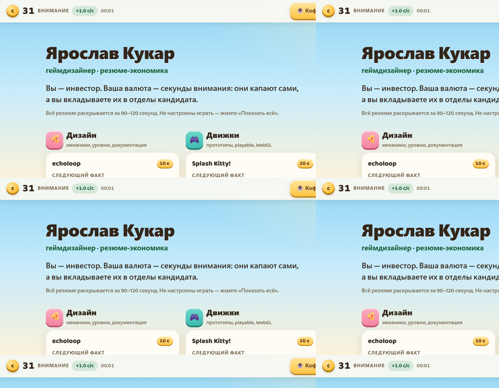
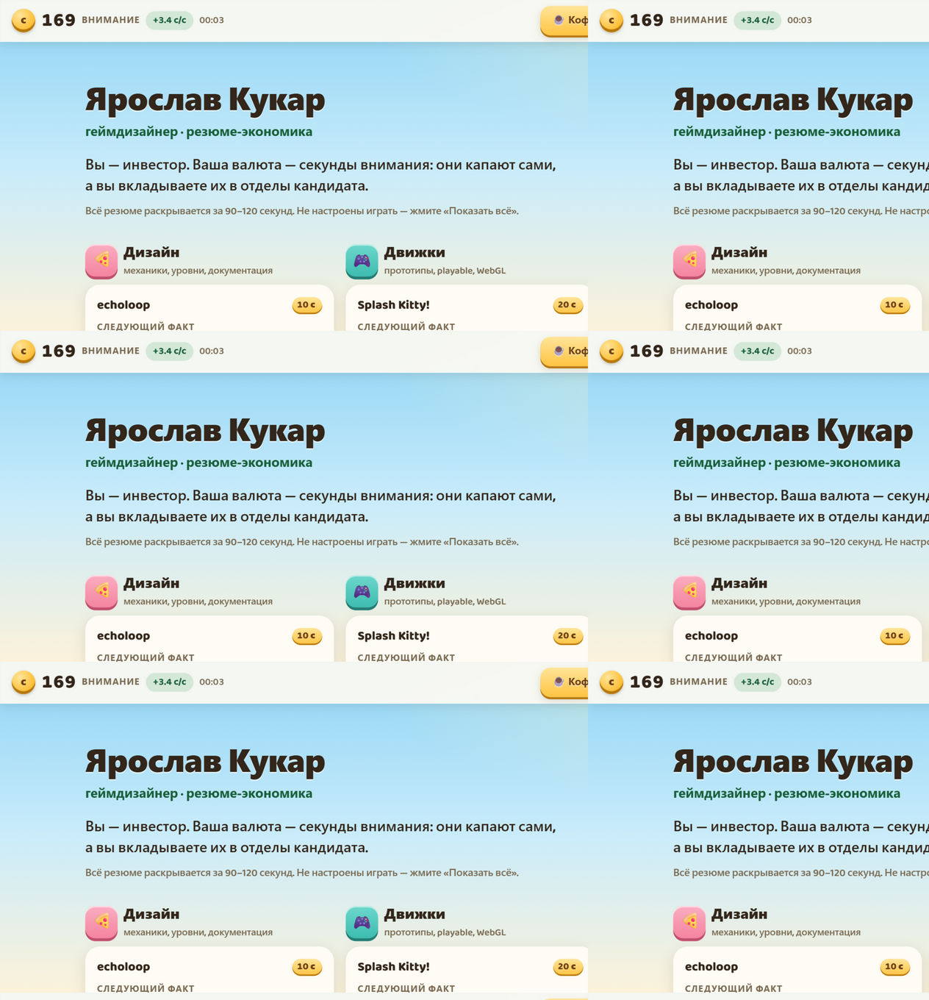
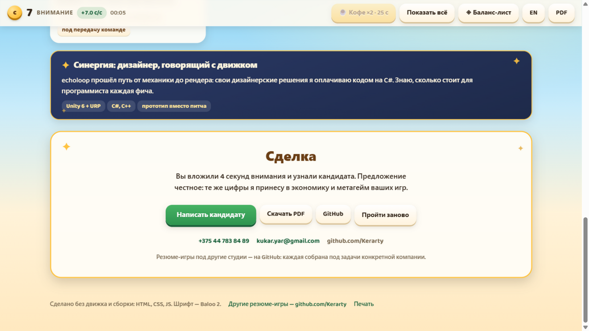
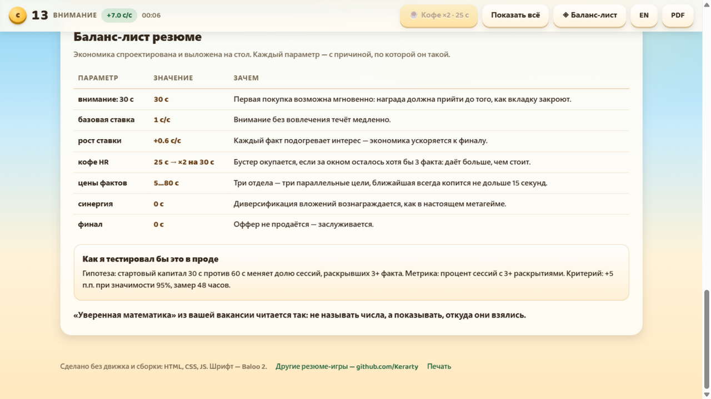
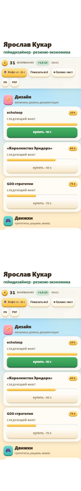

# Кандидат.Инк — резюме-экономика для OpenMyGame

Интерактивное резюме геймдизайнера: экономика, в которую HR вкладывает секунды внимания. Сделано под [OpenMyGame](https://www.openmygame.com) — казуальную студию со словесными играми, у которой в вакансии Game Designer написано: «экономика и монетизация, data-driven, уверенная математика, понятная документация».

Живая версия: https://kerarty.github.io/cv-openmygame/



## Зачем

Обычное резюме перечисляет требования словами. Это резюме отвечает делом: оно само — спроектированная экономика с ценами, ставками, синергией и бустером, а её баланс-лист открыт для проверки. Кандидат не рассказывает, что умеет считать экономику, — он отдаёт HR пульт от неё.

Визуал собран по скриншотам игр OpenMyGame: тайлы-«подушки» с 3D-гранью, как буквы в «Поваре Слов», пустые клетки кроссворда для нераскрытых фактов, frosted-панели, монетное золото, блёстки и ночное небо «Звёздного Кроссворда» для синергии. HR должен узнать свои игры с первого экрана.

## Как устроено

Вы — инвестор. Валюта — секунды внимания: они капают сами (+1 с/с), а вы вкладываете их в три отдела кандидата. Каждое вложение раскрывает факт-карточку с проектом и цифрами:

- **Дизайн** — echoloop (Unity 6 + URP, 8 уровней, обучение без текста), настольная тактика «Королевства Эридора» (4 фракции, 15+ плейтестов), GDD стратегии
- **Движки** — playable-рекламы Splash Kitty (684 КБ, 0 сетевых запросов) и Mob Rush (472 КБ, процедурный арт и звук), движко-независимый SDK для playable-ads
- **Аналитика** — плейтесты как live-ops цикл, математика решений (A/B: гипотеза, метрика, критерий), экономика самого резюме

Кривая настроена так, что ближайшая покупка всегда копится не дольше 15 секунд, а полный проход занимает 90–120. Время накопления — это время читать предыдущую карточку, поэтому мёртвых секунд нет.



- **Синергия** — раскрыл echoloop и Splash Kitty, получил бесплатную карточку «дизайнер, говорящий с движком». Диверсификация вложений вознаграждается, как в настоящем метагейме
- **Кофе HR** — бустер ×2 на 30 секунд за 25. Окупается, если за окном осталось хотя бы 3 факта; когда его покупать — первая монетизационная развилка резюме
- **Финал** — панель «Сделка»: письмо кандидату, PDF, GitHub. Оффер не продаётся — заслуживается



## Что умеет

- **Режим дизайнера** — баланс-лист: каждый параметр экономики с причиной, по которой он такой, плюс план A/B-теста с критерием решения. «Понятная документация» из вакансии закрыта таблицей



- переключатель RU/EN — весь текст, включая баланс-лист
- мобильная версия: HR откроет с телефона, всё нажимается пальцем



- печатная версия: `@media print` превращает страницу в обычное текстовое резюме, экономика скрыта
- «Показать всё» — каскадное раскрытие для тех, кто не настроен играть
- PDF-версия ([assets/Yaroslav_Kukar_CV.pdf](assets/Yaroslav_Kukar_CV.pdf)) — кнопка в HUD и в финале

## Экономика в цифрах

Жадная стратегия на реальной модели: покупки на 0, 0, 2, 15, 28, 43, 57, 72 и 85-й секунде — полный проход за 85 секунд без бустера, каждая пауза 13–15 секунд. Симуляция, таблица цен и обоснования — в [docs/GDD.md](docs/GDD.md).

## Запуск

Статика без сборки и зависимостей — открыть `index.html` в браузере. Локальный сервер:

```bash
python -m http.server 8123
```

## Структура

| Файл | Что это |
|---|---|
| `index.html` | Каркас: только контейнеры, текст — в `content.js` |
| `styles.css` | Визуальный язык игр OpenMyGame: тайлы, 3D-кнопки, клетки кроссворда, `@media print` |
| `content.js` | Весь текст, русский и английский. Править только его |
| `economy.js` | Модель экономики: цены, ставки, бустер, синергия |
| `idle.js` | Движок: тик, покупки, бустер, каскад, финал |
| `main.js` | Рендер, язык, режим дизайнера, «Показать всё» |
| `docs/GDD.md` | Концепт-документ с экономической моделью и симуляцией |
